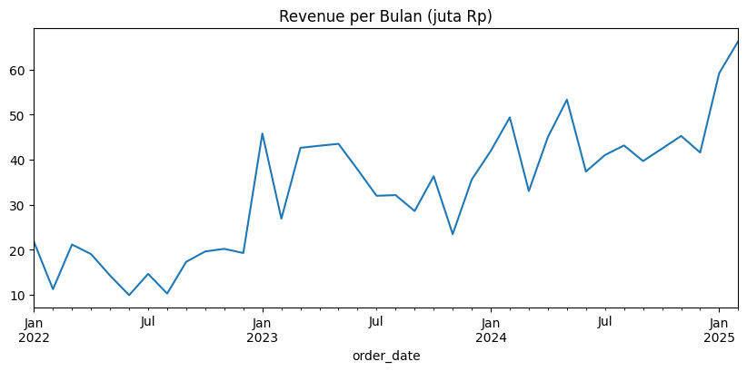
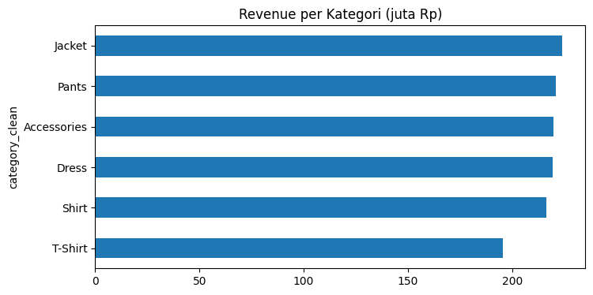

# Gayanara E-commerce: Analisis Penjualan Toko Fashion Online

Proyek portofolio data analyst. Saya berperan sebagai analyst baru di toko baju online, membersihkan data yang sengaja dibuat berantakan, lalu menggali penjualan untuk menghasilkan rekomendasi bisnis.

> Dataset simulasi "Gayanara: Toko Fashion Online" dari [ngulikdata.com](https://ngulikdata.com). Semua data bersifat fiktif.

## Pertanyaan Bisnis
1. Bagaimana tren revenue per bulan?
2. Kategori dan kota mana yang paling menghasilkan?
3. Apakah promo menaikkan nilai order?
4. Seberapa besar order gagal (cancelled/returned) dan di mana pola tertingginya?

## Data
5 tabel: products (300), customers (800), orders (3.000), order_items (4.986), reviews (1.500). Periode Jan 2022 sampai Feb 2025.

## Langkah
| Notebook | Isi |
|---|---|
| `01_data_cleaning.ipynb` | Standarisasi kategori, flag email dobel, flag order sebelum registrasi, validasi total order, definisi revenue |
| `02_eda.ipynb` | Tren bulanan, kategori, kota, promo, order gagal |
| `03_insights.ipynb` | Ringkasan, temuan, rekomendasi, keterbatasan |

## Temuan Utama
- Revenue Rp1,27 miliar dari 2.521 order valid, rata-rata Rp501.920 per order
- Revenue naik sejak awal 2023, puncak Feb 2025 (Rp66,3 juta)
- Kategori dan kota merata, T-Shirt paling rendah
- Promo dipakai 41% order tapi nilai ordernya sekitar 6% lebih kecil
- 16% order gagal, J&T dan OVO tertinggi (selisih kecil)

## Visualisasi

## Keputusan Cleaning
- Email dobel: 3 pasang, customer berbeda, jadi diberi flag, tidak dihapus
- 795 order (26%) tercatat sebelum tanggal registrasi: diberi flag, data tetap dipakai
- Revenue = `total_amount_idr` (sudah net diskon, belum termasuk ongkir), hanya status delivered, shipped, processing

## Cara Menjalankan
1. Unduh repo ini (tombol hijau **Code**, lalu **Download ZIP**, dan ekstrak) atau jalankan `git clone https://github.com/pajareeeee/gayanara_ecommerce_analysis.git`
2. Unduh dataset gratis dari [halaman Ngulik Data](https://ngulikdata.com/datasets/gayanara) (perlu isi nama dan email), lalu buat folder `data/` dan taruh 5 file CSV di dalamnya: products.csv, customers.csv, orders.csv, order_items.csv, reviews.csv
3. Install library: `pip install pandas matplotlib jupyter`
4. Jalankan notebook berurutan: 01, 02, 03 (notebook 01 membuat folder `data_clean/`)

Diuji dengan Python 3.12.

## Tools
Python, pandas, matplotlib, Jupyter (VS Code)